<p align="center">
  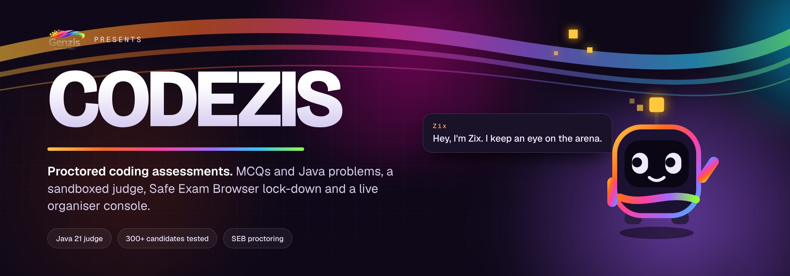
</p>

<p align="center">
  <b>Codezis</b> is a proctored online coding-assessment platform by <b>Genzis</b>.<br>
  MCQs and Java problems, a sandboxed judge with hidden tests and partial scoring, Safe Exam Browser lock-down and a live organiser console.
</p>

<p align="center">
  
  
  
  
  
  
</p>

<p align="center">
  <a href="#see-it-in-30-seconds">Preview</a> ·
  <a href="#a-walk-through-the-exam">Screens</a> ·
  <a href="#meet-zix">Zix</a> ·
  <a href="#features">Features</a> ·
  <a href="#run-locally">Run locally</a> ·
  <a href="#production">Production</a> ·
  <a href="#docs">Docs</a>
</p>

---

Built to run a 300–500 candidate online codeathon on a single VM, and structured to grow into hiring assessments and a multi-tenant SaaS.

## See it in 30 seconds

No MongoDB, Docker or judge needed. Preview mode serves the real frontend against a fake API, so you can click through every candidate screen.

```bash
cd client
npm install
npm run preview:demo        # builds, then serves http://localhost:4400
```

Sign in with **any email and any access code**. Tick the agreement in the lobby, start the test, answer a few MCQs, then open a problem and press **Submit** to see the judge return a verdict.

> Preview mode accepts every login. It is for looking at the UI only; never deploy it.

## A walk through the exam

Each part of the test has its own look, so candidates always know where they are.

<table>
  <tr>
    <td width="50%">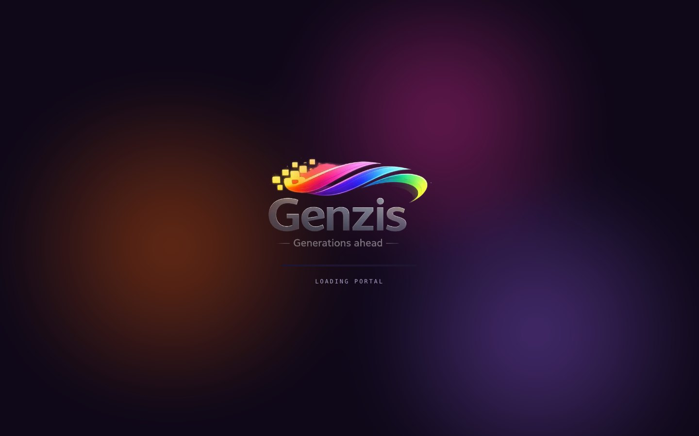</td>
    <td width="50%">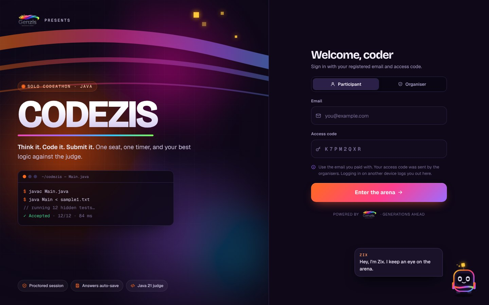</td>
  </tr>
  <tr>
    <td><b>Loader</b>: the Genzis spectrum mark while the portal boots</td>
    <td><b>Sign in</b>: email + access code, organiser tab for staff</td>
  </tr>
  <tr>
    <td>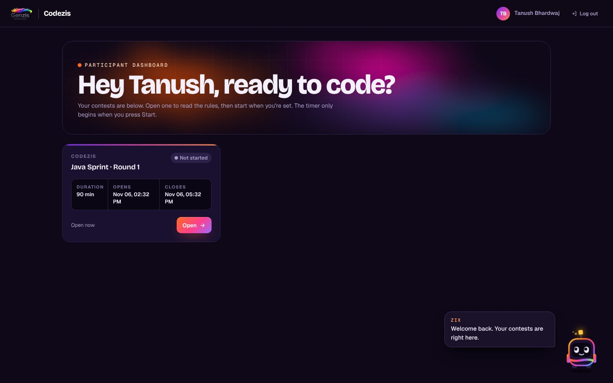</td>
    <td>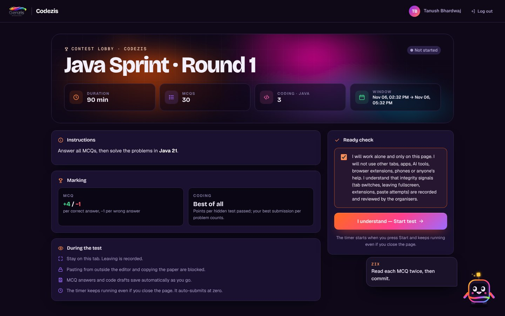</td>
  </tr>
  <tr>
    <td><b>Dashboard</b>: every contest the candidate is registered for</td>
    <td><b>Lobby</b>: rules, marking, live countdown and an integrity agreement</td>
  </tr>
  <tr>
    <td>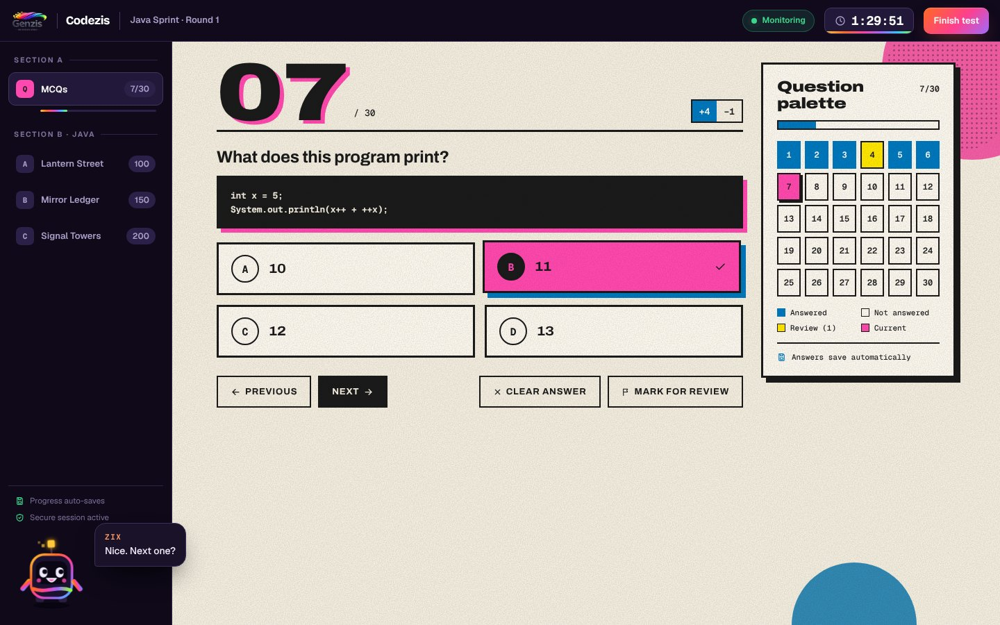</td>
    <td>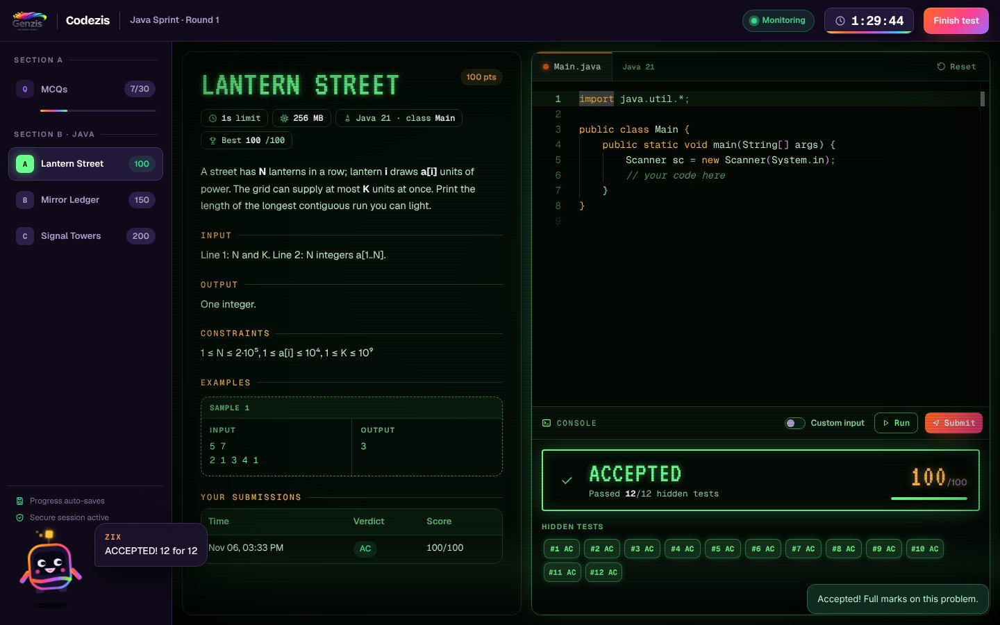</td>
  </tr>
  <tr>
    <td><b>MCQs, risograph paper</b>: big question numbers, cut-paper options, a palette with review flags</td>
    <td><b>Java coding, phosphor CRT</b>: Monaco editor, sample runs, per-test verdicts on submit</td>
  </tr>
  <tr>
    <td>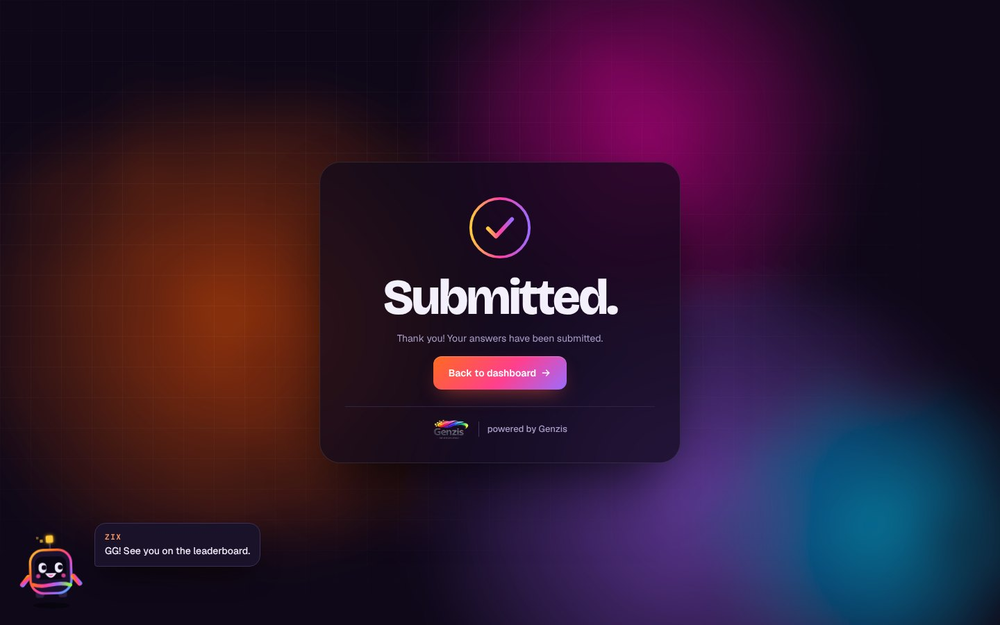</td>
    <td valign="middle">
      <b>Submitted</b>: answers locked, results wait for the organisers.<br><br>
      The design language: dark ink, the Genzis spectrum from the logo, Bricolage Grotesque for headlines, Geist for UI text and Geist Mono for code. All fonts are bundled, because Safe Exam Browser blocks font CDNs.
    </td>
  </tr>
</table>

<details>
<summary><b>Organiser console</b></summary>
<br>

| | |
|---|---|
| 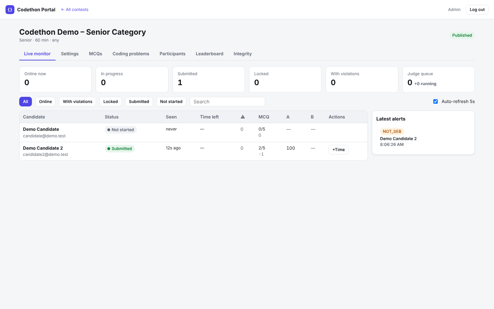 | 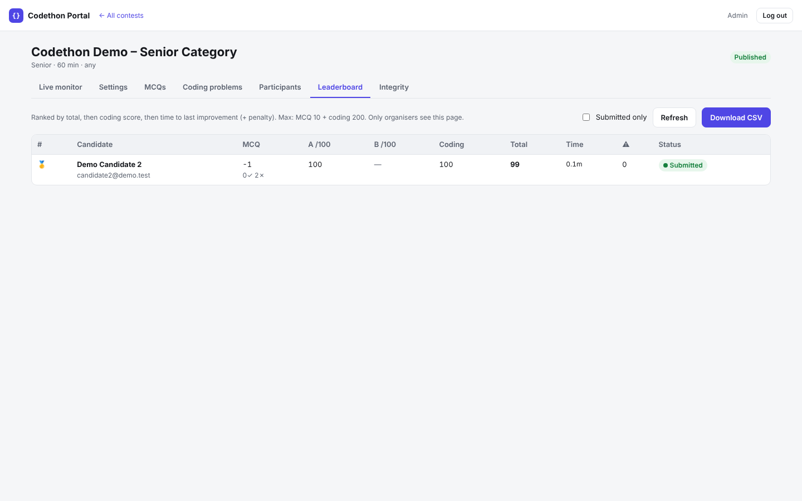 |
| **Live monitor** | **Leaderboard** |
| 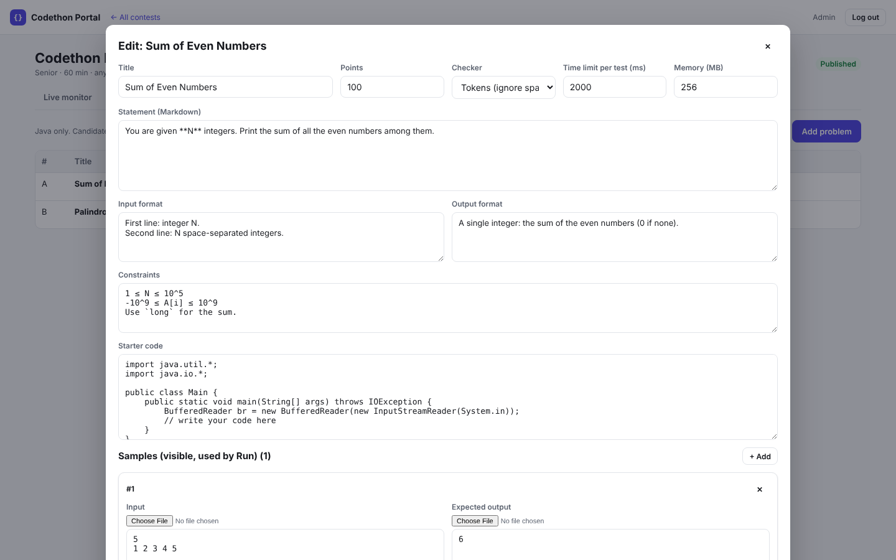 | |
| **Problem editor** | |

</details>

## Meet Zix

<p align="center">
  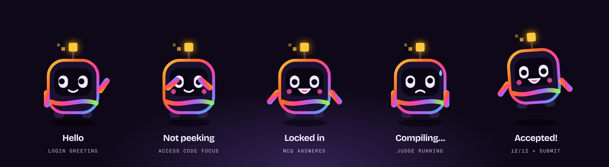
</p>

Zix is the Genzis mascot and rides along on every candidate screen. Its eyes follow the cursor, it blinks, and it dozes off if the candidate goes idle.

| When | Zix does |
|---|---|
| Sign-in page opens | Waves hello |
| Access code field is focused | Covers its eyes: "Not peeking. Promise." |
| An MCQ is answered, cleared or flagged | Hops, thinks or notes the flag |
| Code is compiling | Sweats while the judge runs |
| A submission is accepted | Celebrates and throws pixel confetti |
| A proctoring warning fires | Reminds the candidate it was logged |
| Five minutes are left | Warns to submit what they have |
| The test is submitted | Parties |

Candidates can click Zix for a tip or tuck it into the corner. It never appears in the organiser console, and it renders inside the app root so the proctoring overlay scan ignores it. Code lives in [`client/src/components/Zix.jsx`](client/src/components/Zix.jsx); any component can talk to it with `zixSay(text, mood)` and `zixConfetti()`.

## Features

### Candidate experience
- **Distraction-free exam UI** with a distinct look per section and calm motion; respects reduced-motion settings.
- **Contest lobby** with rules, marking scheme, live countdown and an integrity agreement before Start.
- **MCQ section** with a question palette, mark-for-review and autosave on every answer.
- **Java coding section** with a Monaco editor, sample runs, custom input and per-test verdicts on submit.
- **Server-authoritative timer** that keeps running if the page closes and auto-submits at zero.

### Judge
- Sandboxed Java execution in Docker with **time and memory limits**.
- **Hidden test cases** with partial scoring; the best submission per problem counts.
- Verdicts `AC` `WA` `TLE` `MLE` `RE` `CE`, a judge queue, and horizontally scalable workers.

### Proctoring
- **Safe Exam Browser** lock-down with config-key verification.
- In-browser integrity signals: tab switches, fullscreen exits, paste/copy blocking, multi-screen and extension/overlay detection.
- **Single-device sessions**, violation counts with auto-lock, and a **code-similarity** check across submissions.

### Organiser console
- Contest authoring, MCQ bulk CSV upload, problem editor with hidden tests.
- Participant import from **Razorpay CSV**, with an access code generated per candidate.
- **Live monitor**, integrity review, leaderboard and CSV export.

## Tech stack

| Layer | Stack |
|---|---|
| Frontend | React 18, Vite, Monaco editor, bundled fonts (works under SEB URL filtering) |
| API | Node 20, Express, Mongoose, JWT sessions |
| Judge | Docker sandbox running Java 21, worker processes polling a MongoDB-backed queue |
| Data | MongoDB 7 (self-hosted or Atlas) |
| Edge | Caddy with automatic HTTPS, Docker Compose on one VM |

## Project structure

```
codethon-portal/
├─ server/                 Node 20 + Express + Mongoose
│  ├─ src/index.js         API process
│  ├─ src/worker.js        judge worker process (run 1+ of these)
│  ├─ src/routes/          auth · candidate (/api/c) · admin (/api/admin) · public
│  ├─ src/judge/           sandbox.js (docker/local runner) · judge.js (verdicts + scoring)
│  ├─ src/services/        scoring/leaderboard · plagiarism · CSV import · checkers
│  └─ scripts/             seed · smoke test · load test · create admin · reset
├─ client/                 React 18 + Vite + Monaco editor (Java)
│  ├─ src/pages/           candidate (login, lobby, exam) · admin console
│  ├─ src/components/      Zix mascot · spectrum decor · loader · editor
│  ├─ src/proctor/         browser integrity detector
│  ├─ src/codezis.css      base candidate theme
│  └─ src/codezis-spectrum.css   spectrum, riso and CRT skins + Zix
├─ judge/                  Dockerfile + runner.sh for the Java sandbox image
├─ samples/                demo contest JSON, Razorpay CSV, MCQ CSV
├─ docs/                   BACKEND · DEPLOY · SEB · CONTEST_FORMAT · PLAN · TESTING
├─ docker-compose.yml      Caddy (HTTPS) + API + worker + MongoDB on one VM
└─ scripts/                deploy.sh (one-shot VM deploy) · preview-server.js (UI preview)
```

## Run locally

The full stack needs **Node 20+**, **MongoDB**, and **either** Docker (recommended, the real sandbox) **or** a JDK 17+ with bash (Linux/macOS/WSL, development only). To only look at the UI, use [preview mode](#see-it-in-30-seconds) instead.

```bash
# 1. MongoDB (pick one)
docker run -d --name mongo -p 27017:27017 mongo:7        # or a free MongoDB Atlas cluster

# 2. Config
cp .env.example .env            # set JWT_SECRET, ADMIN_EMAIL, ADMIN_PASSWORD
#   Docker available?  JUDGE_MODE=docker  and build the sandbox once:
docker build -t codethon-java-runner:latest ./judge
#   No Docker (Linux/macOS/WSL + JDK)?  JUDGE_MODE=local   (no sandbox: never for a real contest)

# 3. Server (two terminals)
cd server && npm install
npm run seed            # demo contest + candidate@demo.test / DEMO2026
npm run dev             # API on :5000 (creates the admin from .env)
npm run dev:worker      # judge worker

# 4. Client (third terminal)
cd client && npm install && npm run dev     # http://localhost:5173

# 5. End-to-end check (API + worker running)
cd server && npm run seed && npm run smoke  # expect "All checks passed"
```

**Demo logins**

| Role | Tab | Email | Secret |
|---|---|---|---|
| Organiser | Organiser | `ADMIN_EMAIL` from `.env` | `ADMIN_PASSWORD` from `.env` |
| Candidate | Participant | `candidate@demo.test` | `DEMO2026` |

The demo contest uses browser policy **ANY** so you can test in Chrome. Real contests default to **SEB_REQUIRED**.

## Production

One Linux VM with Docker:

```bash
cp .env.example .env    # fill in DOMAIN, secrets, admin, judge settings
bash scripts/deploy.sh
```

Hosting options, HTTPS, capacity numbers, backups and the event-day runbook are in **[docs/DEPLOY.md](docs/DEPLOY.md)**.

> After pulling UI changes, rebuild the client (`cd client && npm install && npm run build`) so new frontend dependencies, including the bundled fonts, are installed.

## Docs

| Doc | What's inside |
|---|---|
| [BACKEND.md](docs/BACKEND.md) | Architecture, data model, every API endpoint, judge internals |
| [DEPLOY.md](docs/DEPLOY.md) | Hosting, HTTPS, capacity, backups, event-day runbook |
| [SEB.md](docs/SEB.md) | Safe Exam Browser setup and what it does / does not stop |
| [CONTEST_FORMAT.md](docs/CONTEST_FORMAT.md) | Contest JSON, MCQ CSV and participant CSV formats |
| [TESTING.md](docs/TESTING.md) | What has been verified and how to run the checks |
| [PLAN.md](docs/PLAN.md) | Build plan and SaaS roadmap |

---

<p align="center">
  <sub>Built by <b>Genzis</b> · Generations Ahead · <code>genzis.hq@gmail.com</code></sub>
</p>
