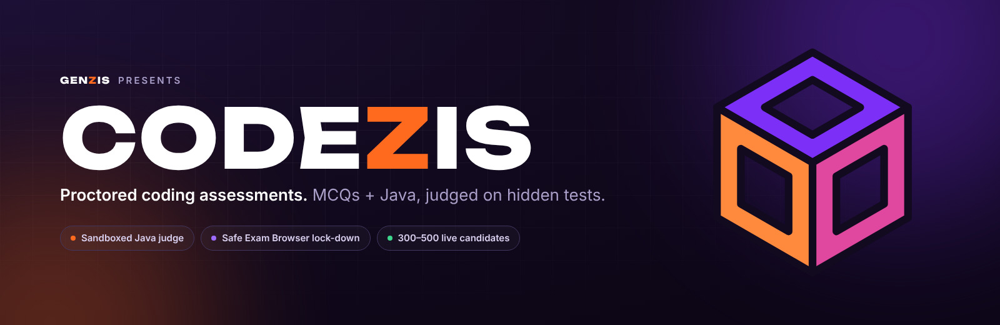
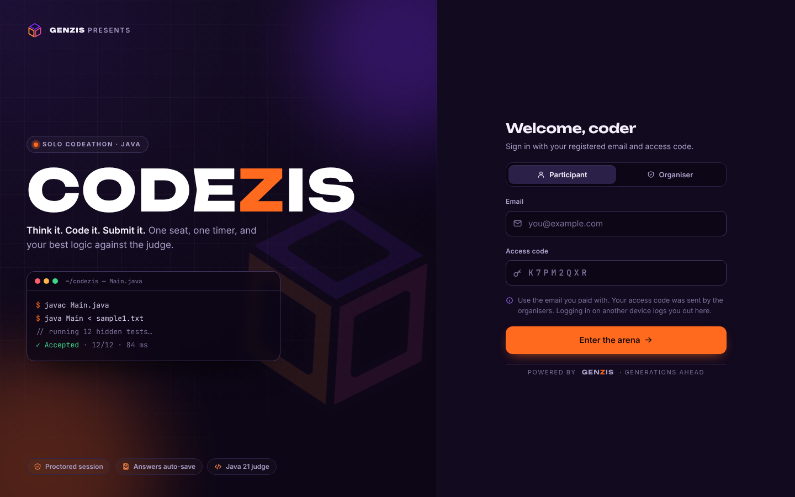
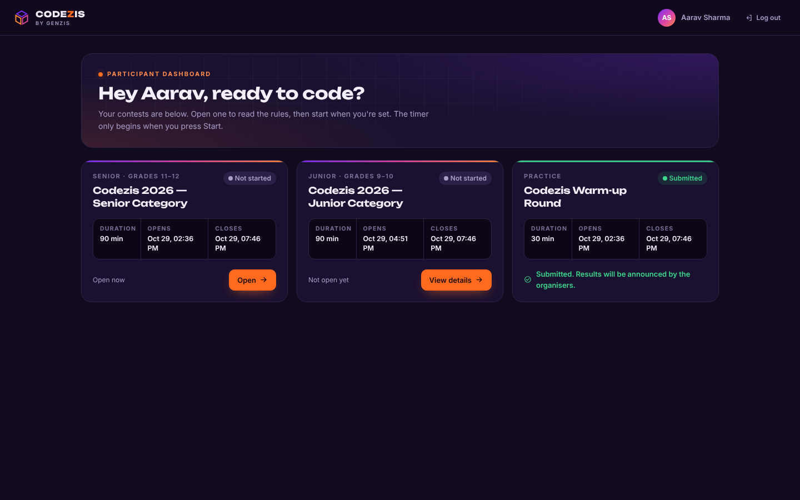
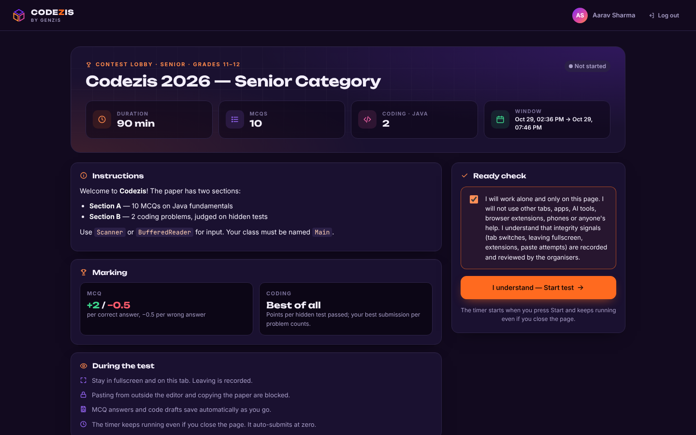
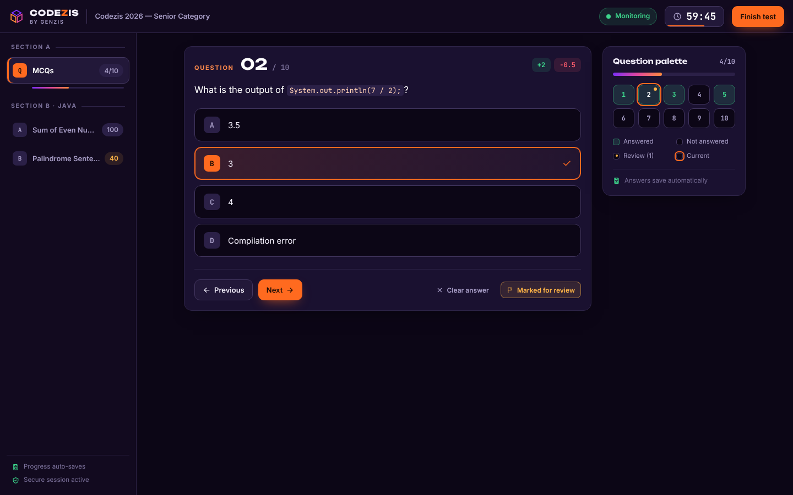
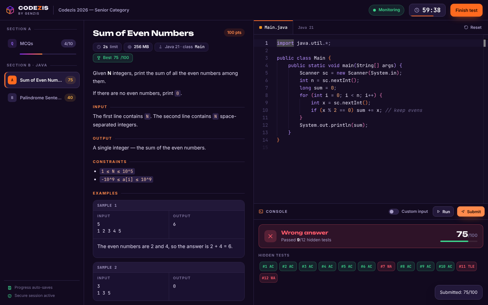
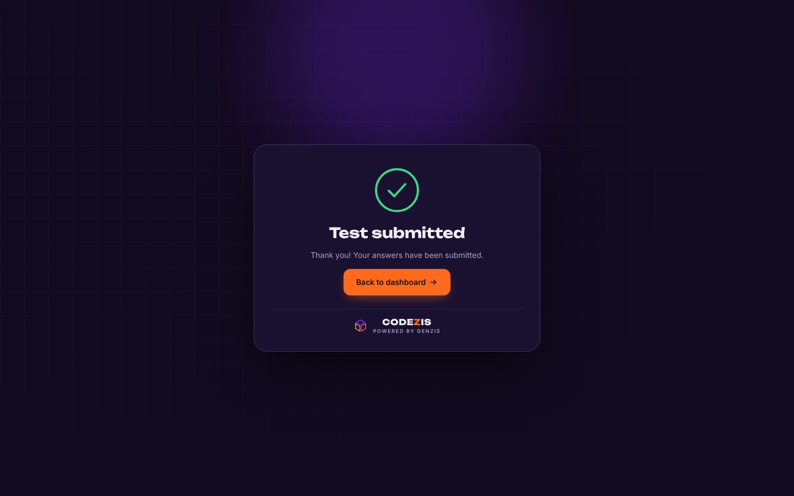

<p align="center">
  
</p>

<p align="center">
  <b>Codezis</b> is a proctored online coding-assessment platform by <a href="mailto:genzis.hq@gmail.com"><b>Genzis</b></a>.<br>
  MCQs and Java problems, a sandboxed judge with hidden tests and partial scoring, Safe Exam Browser lock-down, and a live organiser console.
</p>

<p align="center">
  
  
  
  
  
  
</p>

<p align="center">
  <a href="#features">Features</a> ·
  <a href="#screenshots">Screenshots</a> ·
  <a href="#run-locally">Run locally</a> ·
  <a href="#production">Production</a> ·
  <a href="#docs">Docs</a>
</p>

---

Built to run a 300–500 candidate online codeathon on a single VM, and structured to grow into hiring assessments and a multi-tenant SaaS.

## Features

### Candidate experience
- **Branded, distraction-free exam UI** — dark Codezis theme, calm motion, works on any screen size.
- **Contest lobby** with rules, marking scheme, live countdown and an integrity agreement before Start.
- **MCQ section** with a question palette, mark-for-review and autosave on every answer.
- **Java coding section** with a Monaco editor, sample runs, custom input and per-test verdicts on submit.
- **Server-authoritative timer** that keeps running if the page closes and auto-submits at zero.

### Judge
- Sandboxed Java execution in Docker with **time and memory limits**.
- **Hidden test cases** with partial scoring; the best submission per problem counts.
- Verdicts: `AC` `WA` `TLE` `MLE` `RE` `CE`, a judge queue, and horizontally scalable workers.

### Proctoring
- **Safe Exam Browser** lock-down with config-key verification.
- In-browser integrity signals: tab switches, fullscreen exits, paste/copy blocking, multi-screen and extension/overlay detection.
- **Single-device sessions**, violation counts with auto-lock, and a **code-similarity** check across submissions.

### Organiser console
- Contest authoring, MCQ bulk CSV upload, problem editor with hidden tests.
- Participant import from **Razorpay CSV**, with access codes generated per candidate.
- **Live monitor**, integrity review, leaderboard and CSV export.

## Screenshots

| | |
|---|---|
|  |  |
| **Sign in** — participant / organiser | **Dashboard** — your contests |
|  |  |
| **Lobby** — rules, marking, ready check | **MCQ** — palette, review flags, autosave |
|  |  |
| **Coding** — editor, verdicts, hidden tests | **Submitted** |

<details>
<summary><b>Organiser console</b></summary>

| | |
|---|---|
|  |  |
| **Live monitor** | **Leaderboard** |
|  | |
| **Problem editor** | |

</details>

## Tech stack

| Layer | Stack |
|---|---|
| Frontend | React 18, Vite, Monaco editor, bundled fonts (works under SEB URL filtering) |
| API | Node 20, Express, Mongoose, JWT sessions |
| Judge | Docker sandbox running Java 21, worker processes polling a MongoDB-backed queue |
| Data | MongoDB 7 (self-hosted or Atlas) |
| Edge | Caddy with automatic HTTPS, Docker Compose on one VM |

## Project structure

```
codethon-portal/
├─ server/            Node 20 + Express + Mongoose
│  ├─ src/index.js    API process
│  ├─ src/worker.js   judge worker process (run 1+ of these)
│  ├─ src/routes/     auth · candidate (/api/c) · admin (/api/admin) · public
│  ├─ src/judge/      sandbox.js (docker/local runner) · judge.js (verdicts + scoring)
│  ├─ src/services/   scoring/leaderboard · plagiarism · CSV import · checkers
│  └─ scripts/        seed · smoke test · load test · create admin · reset
├─ client/            React 18 + Vite + Monaco editor (Java)
│  ├─ src/pages/      candidate (login, lobby, exam) · admin console
│  ├─ src/proctor/    browser integrity detector
│  └─ src/codezis.css Codezis candidate theme
├─ judge/             Dockerfile + runner.sh for the Java sandbox image
├─ samples/           demo contest JSON, Razorpay CSV, MCQ CSV
├─ docs/              BACKEND · DEPLOY · SEB · CONTEST_FORMAT · PLAN · TESTING
├─ docker-compose.yml Caddy (HTTPS) + API + worker + MongoDB on one VM
└─ scripts/deploy.sh  one-shot VM deploy
```

## Run locally

Needs **Node 20+**, **MongoDB**, and **either** Docker (recommended, the real sandbox) **or** a JDK 17+ with bash (Linux/macOS/WSL, development only).

```bash
# 1. MongoDB (pick one)
docker run -d --name mongo -p 27017:27017 mongo:7        # or a free MongoDB Atlas cluster

# 2. Config
cp .env.example .env            # set JWT_SECRET, ADMIN_EMAIL, ADMIN_PASSWORD
#   Docker available?  JUDGE_MODE=docker  and build the sandbox once:
docker build -t codethon-java-runner:latest ./judge
#   No Docker (Linux/macOS/WSL + JDK)?  JUDGE_MODE=local   (no sandbox: never for a real contest)

# 3. Server (two terminals)
cd server && npm install
npm run seed            # demo contest + candidate@demo.test / DEMO2026
npm run dev             # API on :5000 (creates the admin from .env)
npm run dev:worker      # judge worker

# 4. Client (third terminal)
cd client && npm install && npm run dev     # http://localhost:5173

# 5. End-to-end check (API + worker running)
cd server && npm run seed && npm run smoke  # expect "All checks passed"
```

**Demo logins**

| Role | Tab | Email | Secret |
|---|---|---|---|
| Organiser | Organiser | `ADMIN_EMAIL` from `.env` | `ADMIN_PASSWORD` from `.env` |
| Candidate | Participant | `candidate@demo.test` | `DEMO2026` |

The demo contest uses browser policy **ANY** so you can test in Chrome. Real contests default to **SEB_REQUIRED**.

## Production

One Linux VM with Docker:

```bash
cp .env.example .env    # fill in DOMAIN, secrets, admin, judge settings
bash scripts/deploy.sh
```

Hosting options, HTTPS, capacity numbers, backups and the event-day runbook are in **[docs/DEPLOY.md](docs/DEPLOY.md)**.

> After pulling UI changes, rebuild the client (`cd client && npm install && npm run build`) so new frontend dependencies are installed.

## Docs

| Doc | What's inside |
|---|---|
| [BACKEND.md](docs/BACKEND.md) | Architecture, data model, every API endpoint, judge internals |
| [DEPLOY.md](docs/DEPLOY.md) | Hosting, HTTPS, capacity, backups, event-day runbook |
| [SEB.md](docs/SEB.md) | Safe Exam Browser setup and what it does / does not stop |
| [CONTEST_FORMAT.md](docs/CONTEST_FORMAT.md) | Contest JSON, MCQ CSV and participant CSV formats |
| [TESTING.md](docs/TESTING.md) | What has been verified and how to run the checks |
| [PLAN.md](docs/PLAN.md) | Build plan and SaaS roadmap |

---

<p align="center">
  <sub>Built by <b>Genzis</b> · Generations Ahead · <a href="mailto:genzis.hq@gmail.com">genzis.hq@gmail.com</a></sub>
</p>
