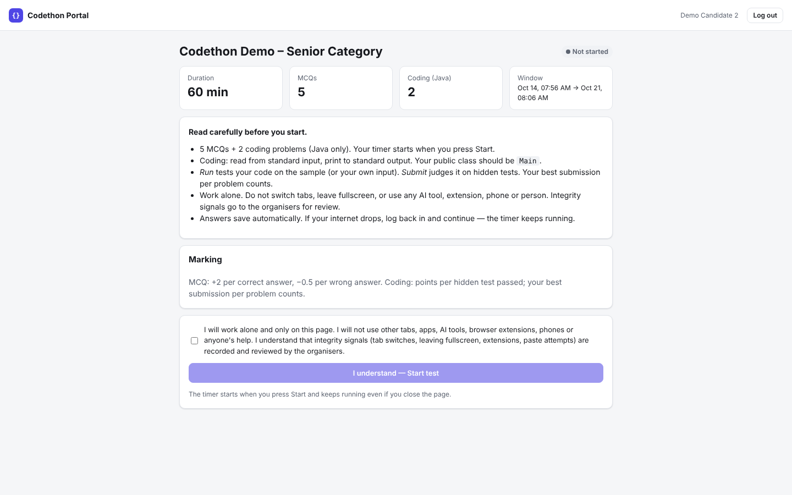
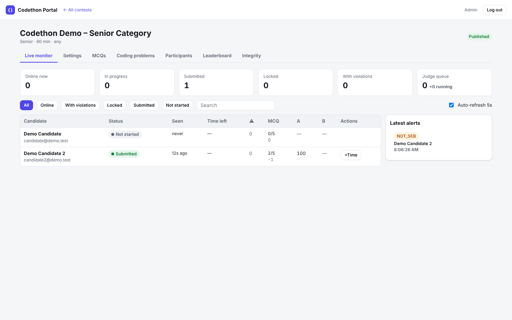
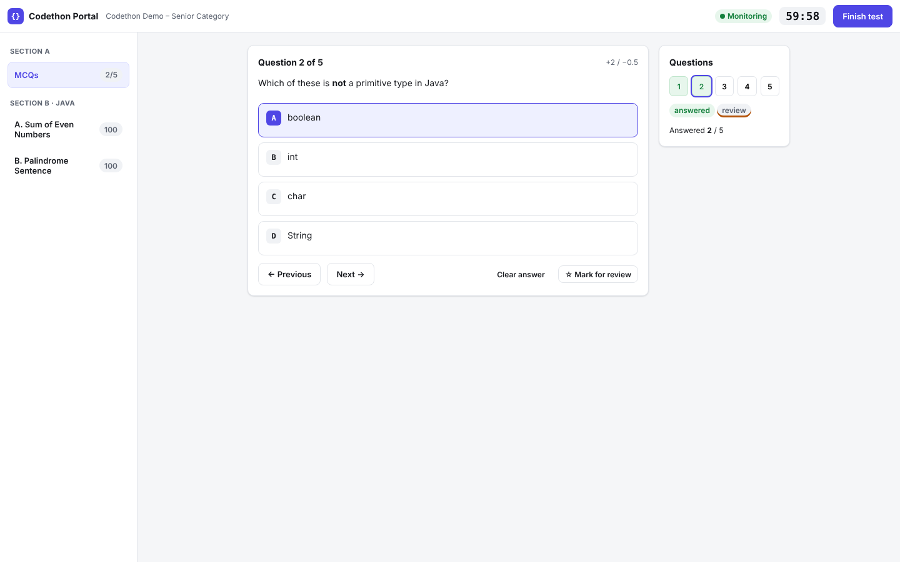
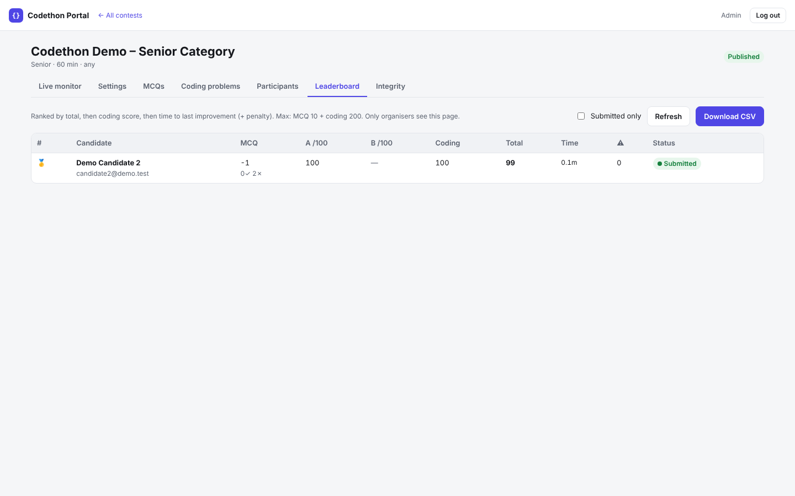
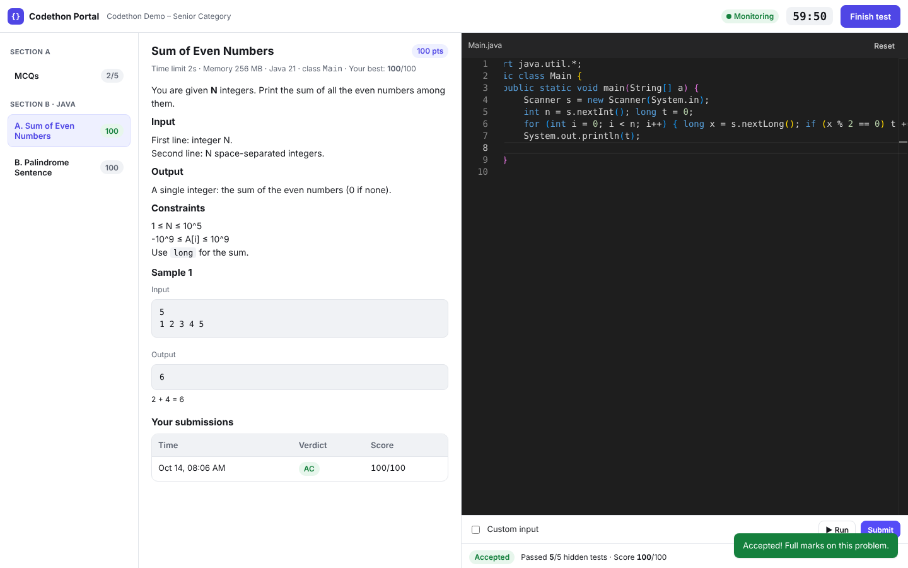
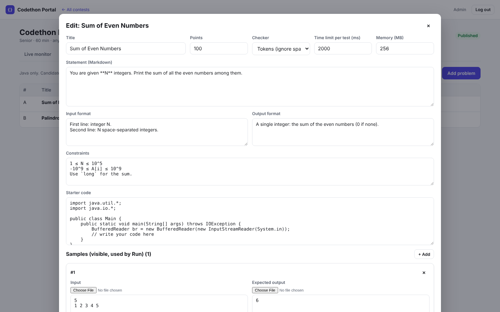

# Codethon Portal

Online coding-assessment platform: **MCQs + Java coding problems**, a sandboxed **judge** (time/memory limits, hidden tests,
partial scoring), **proctoring** (Safe Exam Browser lock-down + in-browser integrity signals + code-similarity check), and an
**admin panel** (contest authoring, Razorpay CSV import, live monitor, leaderboard, CSV export).

Built for a 300–500 candidate online Codethon; structured so it can later become a multi-tenant SaaS (see docs/PLAN.md).

```
codethon-portal/
├─ server/            Node 20 + Express + Mongoose
│  ├─ src/index.js    API process
│  ├─ src/worker.js   judge worker process (run 1+ of these)
│  ├─ src/routes/     auth · candidate (/api/c) · admin (/api/admin) · public
│  ├─ src/judge/      sandbox.js (docker/local runner) · judge.js (verdicts + scoring)
│  ├─ src/services/   scoring/leaderboard · plagiarism · CSV import · checkers
│  └─ scripts/        seed · smoke test · load test · create admin
├─ client/            React 18 + Vite + Monaco editor (Java)
│  └─ src/proctor/    browser integrity detector
├─ judge/             Dockerfile + runner.sh for the Java sandbox image
├─ samples/           demo contest JSON, Razorpay CSV, MCQ CSV
├─ docs/              BACKEND · DEPLOY · SEB · CONTEST_FORMAT · PLAN
├─ docker-compose.yml Caddy (HTTPS) + API + worker + MongoDB on one VM
└─ scripts/deploy.sh  one-shot VM deploy
```

## Run locally (10 minutes)

Needs: Node 20+, MongoDB, and **either** Docker (recommended, the real sandbox) **or** a JDK 17+ with bash (Linux/macOS/WSL, dev only).

```bash
# 1. MongoDB (pick one)
docker run -d --name mongo -p 27017:27017 mongo:7        # or a free MongoDB Atlas cluster

# 2. Config
cp .env.example .env            # set JWT_SECRET, ADMIN_EMAIL, ADMIN_PASSWORD
#   Docker available?  JUDGE_MODE=docker  and build the sandbox once:
docker build -t codethon-java-runner:latest ./judge
#   No Docker (Linux/macOS/WSL + JDK)?  JUDGE_MODE=local   (NO sandbox: never for the real contest)

# 3. Server (terminal 1 + 2)
cd server && npm install
npm run seed            # demo contest + candidate@demo.test / DEMO2026
npm run dev             # API on :5000 (creates the admin from .env)
npm run dev:worker      # judge worker

# 4. Client (terminal 3)
cd client && npm install && npm run dev     # http://localhost:5173

# 5. Check everything end to end (API + worker running)
cd server && npm run seed && node scripts/smoke.js      # expect "All checks passed"
```

Logins: admin = `ADMIN_EMAIL` / `ADMIN_PASSWORD` (tab "Organiser"); candidate = `candidate@demo.test` / `DEMO2026`.
The demo contest uses browser policy **ANY** so you can test in Chrome; real contests default to **SEB_REQUIRED**.

## Production

One Linux VM with Docker: `cp .env.example .env`, fill it in, `bash scripts/deploy.sh`. Full guide, hosting options,
capacity numbers and the event-day runbook: **[docs/DEPLOY.md](docs/DEPLOY.md)**.

## Docs

- [docs/PLAN.md](docs/PLAN.md) – 7-day plan, who does what, test checklist, SaaS roadmap
- [docs/BACKEND.md](docs/BACKEND.md) – architecture, data model, every API endpoint, judge internals (start here, Darshit)
- [docs/DEPLOY.md](docs/DEPLOY.md) – hosting, HTTPS, capacity, backups, event-day runbook
- [docs/SEB.md](docs/SEB.md) – Safe Exam Browser setup and what it does / does not stop
- [docs/CONTEST_FORMAT.md](docs/CONTEST_FORMAT.md) – contest JSON, MCQ CSV, participant CSV formats

## What was tested

Verified in a Linux workspace (JUDGE_MODE=local, MongoDB-compatible test database):

- `scripts/smoke.js`: 22/22 checks pass (login, single-device sessions, start, paper hides answers and hidden tests, MCQ autosave, Run, Submit, cooldown, violations, auto-lock, admin monitor, leaderboard, plagiarism, finish).
- Judge verdicts: AC, WA (partial score), TLE, MLE, RE and CE. A `public class Solution` also works.
- Browser run through the real UI with Playwright: candidate takes the test end to end, outside paste is blocked, and every admin tab renders.
- SEB checks: blocked without SEB. Allowed with a correct `ConfigKeyHash` header or JS-API hash. Blocked with a wrong hash or a foreign origin.
- Load test: 300 simulated candidates on one 2-core box with 0 errors.

**Not tested here:** the Docker sandbox itself (`JUDGE_MODE=docker`), because this workspace could not pull images. On Day 1, run `scripts/deploy.sh` and its self-test on the VM.

## Screenshots

| Candidate | Organiser |
|---|---|
|  |  |
|  |  |
|  |  |
